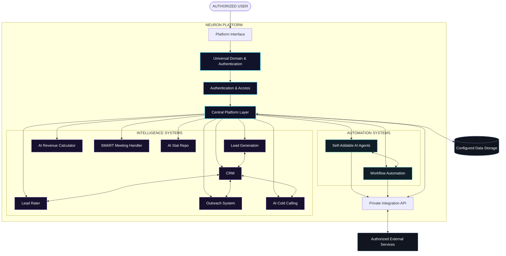
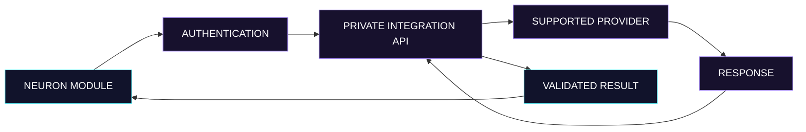

<div align="center">


### `ONE CORE.` `MANY MINDS.` `INFINITE POSSIBILITIES.`

**The AI-powered business automation ecosystem.**

<br/>

[](#-the-thesis)
[](#-core-systems)
[](#-system-architecture)
[](#-roadmap)

<br/>

<a href="#-core-systems">EXPLORE SYSTEMS</a> &nbsp; ◈ &nbsp;
<a href="#-system-architecture">ARCHITECTURE</a> &nbsp; ◈ &nbsp;
<a href="#-universal-api--integrations">INTEGRATIONS</a> &nbsp; ◈ &nbsp;
<a href="#-roadmap">ROADMAP</a>

<br/><br/>


<sub>LEAD INTELLIGENCE &nbsp;•&nbsp; AI AGENTS &nbsp;•&nbsp; WORKFLOW AUTOMATION &nbsp;•&nbsp; BUSINESS OPERATIONS</sub>

</div>

---

## ◈ 01 — THE THESIS

<div align="center">

### BUSINESS OPERATIONS, RECONNECTED.

</div>

NEURON is an AI-powered business automation ecosystem designed to unify lead generation, CRM, outreach, AI calling, configurable agents, workflow automation, integrations, and business intelligence into one connected platform.

The goal isn't to add another disconnected business tool.

**The goal is to build the connective intelligence layer between them.**

| PRINCIPLE | MISSION |
|:---|:---|
| `01 / UNIFY` | Bring business operations into one connected ecosystem. |
| `02 / AUTOMATE` | Reduce repetitive work with configurable workflows. |
| `03 / INTELLIGENCE` | Help qualify leads, interpret data, and support decisions. |
| `04 / INTEGRATE` | Connect supported external services through APIs. |
| `05 / SCALE` | Design modular systems that can expand with business needs. |

<div align="center">

```text
       DISCOVER
          ↓
       QUALIFY
          ↓
       ENGAGE
          ↓
       AUTOMATE
          ↓
        ANALYZE
          ↓
       OPTIMIZE
```

*One connected workflow. Multiple specialized systems.*

</div>

---

## ◈ 02 — CORE SYSTEMS

<div align="center">

`INTELLIGENCE` × `AUTOMATION` × `INTEGRATION`

</div>

### ⟡ CRM — Customer Relationship Management

A centralized workspace for organizing customer relationships and tracking opportunities.

- Centralized contact and prospect records
- Lead pipeline and status tracking
- Interaction history and follow-up organization
- Customer relationship visibility
- Integration with supported lead and outreach workflows

### ⟡ Lead Generation

A system for discovering, collecting, and organizing potential business prospects through configured sources.

- Lead discovery and collection
- Prospect data organization
- Source-based lead management
- Qualification support
- CRM handoff and workflow integration

*Available data depends on connected providers, permissions, API access, and applicable platform rules.*

### ⟡ Outreach System

An outreach layer for organizing prospect communication and supporting personalized engagement.

- AI-assisted message personalization
- Prospect-specific communication workflows
- Follow-up coordination
- Outreach status tracking
- Campaign performance analysis

### ⟡ Self-Addable AI Agents

A configurable agent system intended to let authorized users create specialized agents for distinct tasks.

- Task-specific agent configurations
- Defined responsibilities and instructions
- Supported tool and API connections
- Reusable automation components
- Centralized agent management

### ⟡ Private Integration API

A dedicated integration layer for connecting NEURON with authorized applications and supported external services.

- API-based service connections
- Authentication and authorization
- Configurable integration endpoints
- Structured request and response handling
- Extensible provider architecture

### ⟡ Universal Domain & Integrated Authentication

A unified access layer intended to simplify access to the platform and supported connected services.

- Domain-based platform access
- Authentication integration
- Protected API access
- Consistent integration configuration
- Access-control support

*Actual domain routing, single sign-on, and authentication behavior depend on implementation.*

### ⟡ Workflow Automation

A system for connecting triggers, conditions, and actions into repeatable business workflows.

- Trigger-based execution
- Multi-step task sequences
- Cross-service automation
- Configurable workflow logic
- Execution monitoring and error handling

### ⟡ AI Cold Calling System

An AI-assisted calling system intended to support calling workflows and follow-up organization.

- Configurable calling workflows
- Supported voice-provider integrations
- Call outcome tracking
- Follow-up coordination
- Connection to lead management workflows

*Calling requires a compatible provider, appropriate permissions, and compliance with applicable consent and telemarketing laws.*

### ⟡ Lead Rater

A lead-prioritization system based on configurable scoring criteria and available prospect information.

| SIGNAL | INTERPRETATION |
|:---:|:---|
| 🟢 **GREEN** | Higher priority under configured scoring rules |
| 🟡 **YELLOW** | More qualification or information needed |
| 🔴 **RED** | Lower priority under configured scoring rules |

Scores are estimates based on configured rules and available data, not guarantees of conversion.

### ⟡ AI Revenue Calculator

A planning tool for estimating possible business outcomes using user-defined assumptions.

- Lead and conversion assumptions
- Average deal value
- Estimated deal volume
- Revenue scenario comparisons
- Business planning support

**Illustrative formula**

\[
\text{Estimated Revenue}
=
\text{Expected Deals}
\times
\text{Average Deal Value}
\]

*Estimates are not promises of actual revenue.*

### ⟡ SMART Meeting Handler

A meeting-management system intended to help coordinate scheduling and meeting-related tasks.

- Meeting organization
- Scheduling workflow support
- Calendar integration
- Meeting follow-up coordination
- Connected automation workflows

### ⟡ AI Stat Repo

A centralized space intended to organize business statistics, operational metrics, and analytical outputs.

- Business metric organization
- Performance summaries
- Historical data tracking
- Reporting support
- Decision-support insights

---

## ◈ 03 — SYSTEM ARCHITECTURE

<div align="center">

### ONE PLATFORM. SPECIALIZED SYSTEMS. CONNECTED SERVICES.

</div>



### Architecture principles

- **Modularity:** Each system has a distinct responsibility.
- **Interoperability:** Modules connect through defined interfaces.
- **Security:** Protected operations require appropriate access controls.
- **Extensibility:** New agents and integrations can be added as the implementation grows.
- **Reliability:** Failures, retries, and incomplete operations should be handled deliberately.

*This diagram represents the intended system design. It does not imply that every module, connection, or integration is already operational.*

---

## ◈ 04 — UNIVERSAL API & INTEGRATIONS

The integration layer is intended to provide a consistent way for NEURON modules to communicate with supported external services.



### Integration goals

- Consistent API access patterns
- Protected credentials and tokens
- Structured request and response formats
- Configurable service connections
- Error handling and operational logging
- Extensible provider support

### Security requirements

- Never commit real credentials to a public repository.
- Keep private keys on the server or in a suitable secrets manager.
- Apply least-privilege permissions.
- Validate incoming requests and external responses.
- Protect sensitive endpoints with server-side authorization.
- Avoid exposing tokens or sensitive information in logs.

---

## ◈ 05 — TECH STACK

NEURON's stack should reflect the technologies actually implemented in the repository.

| LAYER | RESPONSIBILITY |
|:---|:---|
| **Frontend** | Platform interface and user experience |
| **Backend** | Business logic and API endpoints |
| **AI Layer** | AI-powered tasks and configurable agents |
| **Database** | Persistent application and business data |
| **Authentication** | Identity and access management |
| **Integration Layer** | External APIs and connected services |
| **Automation Engine** | Triggers, conditions, and workflow execution |
| **Deployment** | Hosting, monitoring, and application delivery |

Update this table with the exact frameworks, services, and versions used by the project.

---

## ◈ 06 — SETUP

### Prerequisites

- Git
- The runtime required by the application
- Project dependencies
- Required environment variables
- Credentials for integrations being tested

### Installation

Clone the repository:

```bash
git clone YOUR_REPOSITORY_URL
cd YOUR_PROJECT_DIRECTORY
```

For a typical npm-based project:

```bash
npm install
```

Configure the environment according to the actual application, then run the relevant script defined in `package.json`.

For example:

```bash
npm run dev
```

**Note:** These are example commands. Use the scripts and instructions defined by the actual project.

### Environment configuration

Example placeholders only:

```env
DATABASE_URL=
AI_PROVIDER_API_KEY=
INTEGRATION_API_KEY=
AUTH_SECRET=
```

Use the exact variable names expected by the application. Never commit real secrets.

---

## ◈ 07 — SECURITY

Security must be considered throughout the development and deployment lifecycle.

| AREA | EXPECTATION |
|:---|:---|
| Authentication | Verify identity before granting access |
| Authorization | Restrict protected operations to permitted users |
| Secrets | Keep credentials outside public source code |
| Input validation | Validate user input and external data |
| Data protection | Protect sensitive data in transit and at rest |
| Logging | Avoid storing passwords, tokens, or unnecessary sensitive data |
| Reliability | Handle failures without leaking private implementation details |

### Production-readiness checklist

- [ ] Verify server-side authentication and authorization.
- [ ] Confirm private keys are not exposed to browsers.
- [ ] Review database permissions and access policies.
- [ ] Test input validation and error handling.
- [ ] Configure rate limits where appropriate.
- [ ] Review external API permissions.
- [ ] Establish data retention and deletion procedures.
- [ ] Test backups, recovery, and monitoring.

These are recommended controls to verify—not claims that all controls are already implemented.

---

## ◈ 08 — ROADMAP

The roadmap tracks intended development milestones.

- [ ] Core platform foundation
- [ ] CRM and lead management
- [ ] Lead generation integrations
- [ ] Lead Rater and qualification logic
- [ ] AI-assisted Outreach System
- [ ] AI Cold Calling integration
- [ ] Self-Addable AI Agents
- [ ] Workflow Automation engine
- [ ] Private Integration API
- [ ] Universal Domain & Integrated Authentication
- [ ] SMART Meeting Handler
- [ ] AI Revenue Calculator
- [ ] AI Stat Repo and analytics
- [ ] Testing and production hardening
- [ ] Monitoring, reliability, and deployment improvements

Update the checklist only when the corresponding work has actually been completed and verified.

---

## ◈ 09 — VISION

<div align="center">

### FROM DISCONNECTED TO CONNECTED.

NEURON aims to bring business systems, configurable AI agents, and supported external services into one coordinated ecosystem.

The long-term vision is a platform where specialized systems can exchange information, assist with operational tasks, automate repeatable workflows, and help businesses make better-informed decisions.

<br/>

**ONE ECOSYSTEM.**

**CONNECTED INTELLIGENCE.**

**SMARTER OPERATIONS.**

<br/>


<sub>NEURON — INTELLIGENCE CONNECTED. WORKFLOWS UNIFIED.</sub>

</div>
