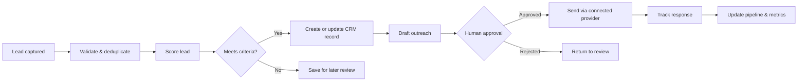
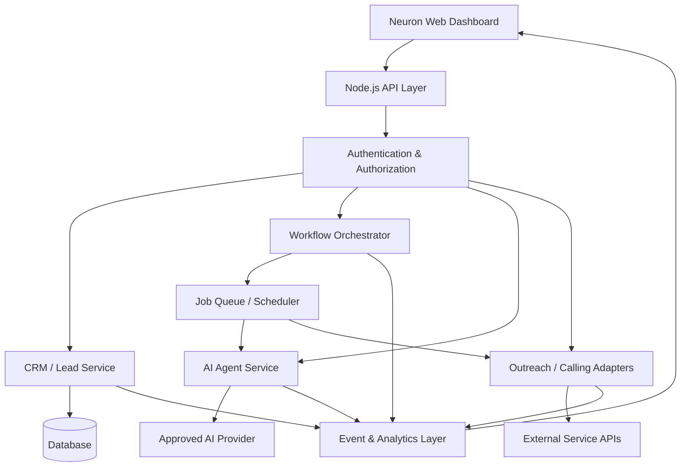

NEURON
THE AI AUTOMATION OPERATING SYSTEM
Capture leads. Activate agents. Automate workflows. Turn operations into measurable growth.

  
  
  
  

ONE COMMAND CENTER. A WHOLE GROWTH WORKFLOW.

Explore the Features · Architecture · Run Locally · Security

[!NOTE]
Product vision / implementation status: This README describes the intended Neuron platform. A feature is only live when its backend, integrations, permissions, and error handling have actually been implemented and tested. Replace demo data and roadmap items with verified capabilities before presenting Neuron as production-ready.

◈ The vision
Neuron is an AI automation platform concept for teams that want to connect lead generation, CRM, outreach, AI agents, workflow orchestration, calling, meetings, and revenue insights in one workspace.

Instead of juggling disconnected tools, Neuron aims to create one connected operating loop:

Discover → Qualify → Enrich → Engage → Schedule → Follow up → Measure → Improve

01 / CAPTURE	02 / CONNECT	03 / AUTOMATE	04 / MEASURE
Find potential leads	Organize relationships	Let workflows do repeatable work	Understand results
Lead discovery	CRM & pipeline	AI agents & orchestration	Revenue analytics

⚡ The Neuron stack
🧠 AI agent workspace
A planned home for task-focused agents, each with a defined purpose, approved tools, scoped permissions, and observable results.
- Agent builder concept — configure an agent's role, instructions, tools, and limits.
- Human approval gates — require review before consequential external actions.
- Run history — inspect inputs, outputs, status, and errors.
- Tool connections — integrate approved APIs without exposing credentials to the browser.
🧲 Automated lead generation
Build a repeatable lead workflow from permitted, reliable data sources.
- Capture leads from authorized APIs, forms, imports, and connected sources.
- Normalize company, contact, source, and status fields.
- Detect likely duplicates and preserve source attribution.
- Enrich records only where access and applicable rules allow.
- Route qualified leads into the CRM with a clear audit trail.
Design principle: no fabricated contacts, fake verification, or claims that a source was checked when it was not.
🗂️ Animated CRM & sales pipeline
A unified workspace concept for the entire lead lifecycle.

NEW → QUALIFIED → CONTACTED → MEETING → PROPOSAL → WON / LOST
- Searchable lead and company records
- Owner, source, tags, notes, and next-action fields
- Pipeline stages and deal-value tracking
- Follow-up reminders and activity timelines
- Duplicate checks and change history
✉️ Outreach engine
Plan, personalize, and monitor outreach without turning it into spam.
- Reusable email templates and approved personalization fields
- Draft → review → approve → send workflow
- Delivery, reply, bounce, and opt-out tracking where supported by the provider
- Suppression lists and contact preferences
- Rate limits, retries, and provider error visibility
☎️ AI-integrated calling
A future calling workspace for authorized business conversations.
- Call queue and contact context
- Human-controlled start/stop and escalation
- Clear disclosure and consent workflows where required
- Call outcome, summary, and next-step capture
- Configurable limits and a human handoff path
Calling requires a legitimate provider integration, lawful use, and applicable consent. Never call emergency numbers, impersonate people, or bypass opt-outs.
🔁 Workflow automation
Connect events to actions through readable, testable workflows.

Potential workflow building blocks:
- Trigger, condition, transform, delay, and action nodes
- Retry policies and failure branches
- Run logs, timestamps, and status indicators
- Test mode before live execution
- Per-workflow permissions and execution limits
💸 AI-integrated revenue calculator
Turn assumptions into transparent estimates—not guaranteed outcomes.
- Lead volume and qualification-rate assumptions
- Meeting, conversion, and average deal-value inputs
- Estimated pipeline and revenue scenarios
- Best-case / expected / conservative comparisons
- Editable assumptions with a visible calculation trail
Forecasts are estimates. Actual revenue depends on conversion, pricing, costs, timing, and many other factors.

📊 Stats & specs provider
A planned analytics layer that makes operational activity easier to understand.
- Leads captured and qualified
- Outreach attempts and provider-reported outcomes
- Meetings booked and pipeline movement
- Workflow success, failure, and retry rates
- Agent run counts, duration, and errors
- Revenue assumptions versus observed outcomes
Metrics should be sourced from actual events and connected providers. Label estimates, missing data, and demo data clearly.
🗓️ Smart meeting handler
- Availability checks through an authorized calendar integration
- Time-zone-aware scheduling
- Confirmation and reminder workflows
- Rescheduling and cancellation handling
- Meeting notes and CRM activity updates
🔌 Private integration API
A controlled integration layer for connecting Neuron to other tools.
- Authenticated API endpoints
- Scoped tokens and permission checks
- Request validation and rate limits
- Webhooks with signature verification
- Versioning, logs, and revocation support
Never expose private API credentials in frontend code, public repositories, logs, or README examples.
🎛️ The command-center experience
The intended interface combines a dark, high-contrast workspace with focused panels for pipeline health, agent activity, workflow execution, and revenue scenarios.

MODULE	WHAT IT SHOULD SHOW
Command Center	Key metrics, alerts, recent events
Lead Intelligence	Sources, qualification, enrichment status
CRM	Contacts, companies, deals, activities
Outreach	Drafts, approvals, delivery outcomes
Agent Lab	Agent configurations, runs, tool permissions
Workflow Studio	Nodes, branches, logs, retries
Call Desk	Authorized call queue, outcomes, handoffs
Revenue Lab	Inputs, formulas, scenario comparisons
Stats & Specs	Source-backed analytics and system health
Integration Vault	Connected apps, scopes, key status

Visual effects belong in the actual web app. GitHub sanitizes README HTML and does not execute custom JavaScript, so interactive panels and sound effects must be implemented in the application itself.
🧬 How the system connects

Suggested separation of responsibilities
- Frontend: user interface, accessible controls, visual feedback.
- Node.js backend: business logic, validation, authorization, integration calls.
- Database: durable records with access controls and backups.
- Worker / queue: background jobs, retries, schedules, and idempotency.
- AI provider adapter: model requests, budgets, structured outputs, and safety checks.
- Integration adapters: email, calendars, calling, and approved data sources.
- Observability: structured logs, metrics, traces, and audit events.
🧰 Suggested project structure
Adapt this to the code that actually exists in your repository.
neuron/
├── assets/
│   └── neuron-banner.svg
├── public/
│   ├── css/
│   ├── js/
│   └── images/
├── src/
│   ├── config/
│   ├── middleware/
│   ├── routes/
│   ├── services/
│   │   ├── crm/
│   │   ├── leads/
│   │   ├── agents/
│   │   ├── workflows/
│   │   ├── outreach/
│   │   ├── calling/
│   │   ├── meetings/
│   │   └── analytics/
│   ├── integrations/
│   ├── jobs/
│   └── utils/
├── tests/
├── .env.example
├── .gitignore
├── package.json
├── package-lock.json
├── server.js
└── README.md
Do not create empty folders just to match this diagram; build the structure as modules become real.
🚀 Run Neuron locally
These steps assume a Node.js application with a package.json and a working start script. Adjust commands to match your actual project.
1. Requirements
- A supported Node.js LTS release
- npm
- The repository cloned to your machine
2. Install dependencies
npm install
3. Configure environment variables
Create a local .env file based on .env.example.
cp .env.example .env
On Windows PowerShell, use:
Copy-Item .env.example .env
Example .env.example with placeholders only:
NODE_ENV=development
PORT=3000

# Add provider keys only when that integration is implemented.
# AI_PROVIDER_API_KEY=
# DATABASE_URL=
# SESSION_SECRET=
# EMAIL_PROVIDER_API_KEY=
# CALENDAR_PROVIDER_API_KEY=
# CALLING_PROVIDER_API_KEY=
Never commit the real .env file or real credentials.
4. Start the app
Use the script defined in package.json, for example:
npm run dev
If your project has no dev script yet, inspect package.json and add a suitable script for your server entry point before running it. Do not assume all integrations work just because the server starts.
🔐 Security-first by design
Neuron may handle contact data, business information, and external-service credentials. Security is part of the product—not a final polish step.
- Keep secrets in environment variables or a dedicated secrets manager.
- Commit .env.example, never real .env values.
- Enforce authentication and authorization on the server for every protected route.
- Use least-privilege, scoped credentials and rotate/revoke compromised keys.
- Validate and sanitize inputs; use parameterized database queries.
- Apply rate limits, request-size limits, and safe error messages.
- Verify webhook signatures and defend against replay where relevant.
- Add audit logs for sensitive actions without logging secrets or unnecessary personal data.
- Require confirmation for consequential actions such as bulk outreach or live calling.
- Respect consent, opt-outs, data minimization, retention, and applicable laws.
- Test authorization failures, duplicate events, retries, and provider outages.
If a secret was ever committed, revoke or rotate it immediately. Deleting it in a later commit does not make the exposed credential safe.
🧪 Quality bar
Before calling a module production-ready, aim for:
- [ ] Input validation and useful error messages
- [ ] Authentication and permission checks
- [ ] Loading, empty, success, and failure states
- [ ] Unit tests for business rules
- [ ] Integration tests for external services
- [ ] Retry and duplicate-event handling
- [ ] Logs and metrics that avoid exposing secrets
- [ ] Clear handling of missing or stale data
- [ ] Accessible keyboard navigation and reduced-motion support
- [ ] Documentation of configuration and limitations
🗺️ Roadmap
Update these checkboxes only when the corresponding work is genuinely complete.
- [ ] Core dashboard and navigation
- [ ] Authentication and role-based permissions
- [ ] CRM contacts, companies, deals, and activity history
- [ ] Lead intake, validation, deduplication, and source tracking
- [ ] Lead scoring with explainable criteria
- [ ] Outreach drafts, approval flow, and opt-out handling
- [ ] Workflow engine with logs, retries, and test mode
- [ ] AI agent configuration and run history
- [ ] Revenue scenario calculator
- [ ] Source-backed analytics and system-health metrics
- [ ] Calendar integration and meeting handling
- [ ] Calling-provider integration with consent safeguards
- [ ] Integration API, webhooks, and token revocation
- [ ] Automated tests, deployment checks, and monitoring
🧩 Design principles
Useful over flashy. Animation should clarify status and hierarchy—not hide important information.

Human control. AI can propose, classify, summarize, and prepare actions; sensitive external actions should have appropriate approval and safeguards.

Evidence over hype. Metrics must come from real events. Estimates must be labeled as estimates.

Modular by design. Integrations should be replaceable, permissions scoped, and failures isolated.

Accessible by default. Respect reduced-motion preferences, provide keyboard access, and never make sound essential to understanding an alert.
🤝 Contributing
Contributions are welcome once the repository's contribution process is defined.
1. Open an issue describing the problem or proposed feature.
2. Discuss significant changes before investing in a large implementation.
3. Create a focused branch.
4. Add or update tests and documentation.
5. Open a pull request with a clear summary and verification steps.
Do not include real customer data, credentials, or private provider responses in issues or pull requests.
📜 License
No license has been specified in this repository yet. Unless and until a license is added, standard copyright rules apply; do not assume others have permission to reuse the code.

NEURON
Connect the signals. Automate the work. See the outcomes.

Built iteratively. Secured intentionally. Measured honestly.

